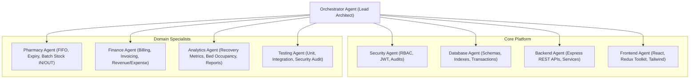

# Smart Healthcare & Hospital Management System: System Architecture Document

## 1. Executive Summary & Orchestration Model

The **Smart Healthcare & Hospital Management System** is an enterprise-grade, multi-tenant-ready hospital management platform built on the MERN stack (MongoDB, Express.js, React.js, Node.js). It digitizes hospital operations across 8 distinct user roles: Super Admin, Hospital Admin, Doctor, Patient, Pharmacist, Receptionist, Accountant, and Department Head.

### Specialized Agent Orchestration Architecture

To deliver production-grade quality, the development lifecycle is partitioned across 9 specialized agent domains:



---

## 2. Technology Stack & Technical Rationale

| Layer | Technology | Selection Rationale |
|---|---|---|
| **Frontend UI** | React.js (v18+) + Vite / CRA | High-performance SPA with virtual DOM, component reusability, and rich ecosystem. |
| **State Management** | Redux Toolkit (RTK) + RTK Query | Predictable global state, unified cache management for API queries, normalized entity state. |
| **Styling & Design System** | Tailwind CSS + Lucide React | Utility-first, responsive, tokenized design system matching modern medical dashboard aesthetics. |
| **Data Visualization** | Recharts | Composable charting library built on SVG for patient recovery curves, revenue/expense trends. |
| **Backend Runtime** | Node.js (v20+ LTS) | Asynchronous, non-blocking I/O ideal for concurrent hospital traffic and audit logging. |
| **Web Framework** | Express.js | Robust middleware ecosystem for security (Helmet, CORS, Rate Limiting), routing, and controllers. |
| **Primary Database** | MongoDB (v7+) with Mongoose ODM | Document database schema with strict Mongoose validation, multi-document ACID transactions for billing and inventory. |
| **Authentication & AuthZ** | JWT + bcryptjs + Custom RBAC Middleware | Stateless authorization with short-lived access tokens, refresh tokens, and granular permission checking. |
| **Validation Layer** | Zod / Joi & Express-Validator | Schema validation at API boundaries preventing malicious inputs and enforcing data integrity. |
| **Audit & Logging** | Winston + Morgan | Structured JSON logging capturing timestamps, user ID, IP address, action, and target entity for HIPAA-aligned audit trails. |

---

## 3. High-Level System Architecture & Flow

```mermaid
flowchart LR
    Client["React Frontend (Tailwind + RTK)"]
    Gateway["Express Gateway / Security Layer (Rate-limit, Helmet, CORS)"]
    AuthMiddleware["JWT & RBAC Middleware"]
    
    subgraph Service Layer
        AuthService["Auth & User Service"]
        PatientService["Patient & Clinical Service"]
        DoctorService["Doctor & Schedule Service"]
        ApptService["Appointment Service"]
        PharmService["Pharmacy & Stock Service"]
        FinanceService["Finance & Billing Service"]
        AnalyticsService["Analytics & Reports Service"]
        FacilityService["Facilities & Bed Service"]
    end
    
    subgraph Data & Storage Layer
        Mongo[(MongoDB Database)]
        AuditLogStore[(Audit Logs Collection)]
    end

    Client -->|HTTPS / REST| Gateway
    Gateway --> AuthMiddleware
    AuthMiddleware --> AuthService
    AuthMiddleware --> PatientService
    AuthMiddleware --> DoctorService
    AuthMiddleware --> ApptService
    AuthMiddleware --> PharmService
    AuthMiddleware --> FinanceService
    AuthMiddleware --> AnalyticsService
    AuthMiddleware --> FacilityService
    
    Service Layer -->|Mongoose ODM| Mongo
    AuthMiddleware -.->|Track sensitive actions| AuditLogStore
    Service Layer -.->|Audit trails| AuditLogStore
```

---

## 4. Repository & Project Directory Structure

```text
healthcare-management/
├── docs/                               # Architectural and technical documentation
│   ├── ARCHITECTURE.md                 # System architecture specification
│   ├── DATABASE_DESIGN.md              # MongoDB collections, schemas, indexes
│   ├── API_DOCUMENTATION.md            # REST API endpoints, RBAC permissions
│   └── IMPLEMENTATION_ROADMAP.md       # Phased delivery plan & test criteria
├── backend/                            # Node.js + Express REST API Server
│   ├── package.json
│   ├── .env.example
│   ├── server.js                       # Application entry point
│   ├── src/
│   │   ├── config/                     # Database, environment, and constants
│   │   │   ├── db.js
│   │   │   └── constants.js
│   │   ├── models/                     # Mongoose Schemas (19 collections)
│   │   │   ├── User.js
│   │   │   ├── Patient.js
│   │   │   ├── Doctor.js
│   │   │   ├── Department.js
│   │   │   ├── Appointment.js
│   │   │   ├── MedicalRecord.js
│   │   │   ├── Prescription.js
│   │   │   ├── Medicine.js
│   │   │   ├── InventoryTransaction.js
│   │   │   ├── Supplier.js
│   │   │   ├── Admission.js
│   │   │   ├── Room.js
│   │   │   ├── Bed.js
│   │   │   ├── Bill.js
│   │   │   ├── Payment.js
│   │   │   ├── Expense.js
│   │   │   ├── Facility.js
│   │   │   ├── Notification.js
│   │   │   └── AuditLog.js
│   │   ├── middlewares/                # Authentication, authorization, error handler
│   │   │   ├── auth.js                 # JWT verification
│   │   │   ├── rbac.js                 # Role & permission validation
│   │   │   ├── auditLogger.js          # Audit logging interceptor
│   │   │   ├── validate.js             # Request validator middleware
│   │   │   └── errorHandler.js         # Centralized error handler
│   │   ├── controllers/                # Request handling & orchestration
│   │   │   ├── authController.js
│   │   │   ├── patientController.js
│   │   │   ├── doctorController.js
│   │   │   ├── departmentController.js
│   │   │   ├── appointmentController.js
│   │   │   ├── medicalRecordController.js
│   │   │   ├── prescriptionController.js
│   │   │   ├── pharmacyController.js
│   │   │   ├── admissionController.js
│   │   │   ├── financeController.js
│   │   │   ├── facilityController.js
│   │   │   ├── analyticsController.js
│   │   │   └── reportController.js
│   │   ├── services/                   # Core business logic & DB transactions
│   │   │   ├── inventoryService.js     # Stock IN/OUT with atomicity
│   │   │   ├── billingService.js       # Invoicing, charge calculation
│   │   │   └── analyticsService.js     # Recovery rate, revenue aggregate pipeline
│   │   ├── routes/                     # API Route definitions
│   │   │   ├── authRoutes.js
│   │   │   ├── patientRoutes.js
│   │   │   ├── doctorRoutes.js
│   │   │   ├── departmentRoutes.js
│   │   │   ├── appointmentRoutes.js
│   │   │   ├── medicalRecordRoutes.js
│   │   │   ├── prescriptionRoutes.js
│   │   │   ├── pharmacyRoutes.js
│   │   │   ├── admissionRoutes.js
│   │   │   ├── financeRoutes.js
│   │   │   ├── facilityRoutes.js
│   │   │   ├── analyticsRoutes.js
│   │   │   └── reportRoutes.js
│   │   └── utils/                      # Helper utilities, ID generators, PDF generator
│   │       ├── idGenerator.js          # Auto-generating PID, DOC-ID, INV-ID
│   │       ├── logger.js
│   │       └── pdfExport.js
│   └── tests/                          # Automated backend tests (Jest / Supertest)
└── frontend/                           # React SPA (Vite / CRA + Tailwind CSS)
    ├── package.json
    ├── tailwind.config.js
    ├── src/
    │   ├── api/                        # Axios instance / RTK Query endpoints
    │   ├── assets/                     # Images, icons, static resources
    │   ├── components/                 # Reusable atomic UI components
    │   │   ├── common/                 # Buttons, inputs, modals, tables, badges
    │   │   ├── layout/                 # Sidebar, Navbar, Header, DashboardShell
    │   │   ├── charts/                 # Line, Bar, Pie charts (Recharts)
    │   │   └── guards/                 # ProtectedRoute, RoleGuard
    │   ├── context/                    # Theme, Notification contexts
    │   ├── features/                   # Redux slices per domain
    │   │   ├── auth/authSlice.js
    │   │   ├── patients/patientSlice.js
    │   │   ├── doctors/doctorSlice.js
    │   │   ├── appointments/appointmentSlice.js
    │   │   ├── pharmacy/pharmacySlice.js
    │   │   ├── finance/financeSlice.js
    │   │   └── analytics/analyticsSlice.js
    │   ├── pages/                      # Role-specific & module views
    │   │   ├── auth/                   # Login, Register, ForgotPassword
    │   │   ├── admin/                  # Super Admin & Hospital Admin Dashboards
    │   │   ├── doctor/                 # Doctor appointments, consultations, Rx
    │   │   ├── patient/                # Patient portal, booking, history
    │   │   ├── pharmacy/               # Stock IN/OUT, low-stock alerts
    │   │   ├── finance/                # Invoices, expenses, profit/loss
    │   │   ├── admissions/             # Inpatient admissions, bed tracker
    │   │   └── reports/                # Report generation & exports
    │   ├── routes/                     # App router with RBAC wrappers
    │   └── utils/                      # Date formatters, currency formatters
```

---

## 5. Security & Role-Based Access Control (RBAC) Matrix

### Standard User Roles:
1. `SUPER_ADMIN`
2. `HOSPITAL_ADMIN`
3. `DOCTOR`
4. `PATIENT`
5. `PHARMACIST`
6. `RECEPTIONIST`
7. `ACCOUNTANT`
8. `DEPARTMENT_HEAD`

### Role-to-Feature Permission Mapping:

| Module / Operation | Super Admin | Hospital Admin | Doctor | Patient | Pharmacist | Receptionist | Accountant | Dept Head |
|---|:---:|:---:|:---:|:---:|:---:|:---:|:---:|:---:|
| User & System Admin | Full | Branch Only | None | None | None | None | None | Read Staff |
| Patient Registration | Read/Write | Read/Write | Read | Self (R/W) | Read | Read/Write | Read | Read Dept |
| Doctor Management | Full | Full | Read Self | Read Public | None | Read Public | None | Read Dept |
| Department Mgmt | Full | Read/Write | Read Dept | Read Public | Read Dept | Read Public | None | Manage Dept |
| Appointment Booking | Manage | Manage | View/Update | Book/Cancel | None | Manage | None | Dept View |
| Medical Records | Audit Only | None | Create/Update | View Self | None | None | None | Dept Audit |
| Prescriptions | Audit Only | None | Create/Update | View Self | Process/Dispense | None | None | Dept View |
| Medicine Inventory | View | View | None | None | Full IN/OUT | None | View Cost | View Dept |
| Admissions & Beds | Full | Manage | Manage Pt | View Self | None | Admit/Discharge | View Bills | Dept Ward |
| Billing & Invoices | Full | View/Manage | None | View Self | None | None | Full R/W | None |
| Expense Management | Full | Full | None | None | None | None | Full R/W | Dept Budget |
| Analytics & Reports | Full | Full | Dept Clinical | None | Pharmacy | Operational | Financial | Dept Level |
