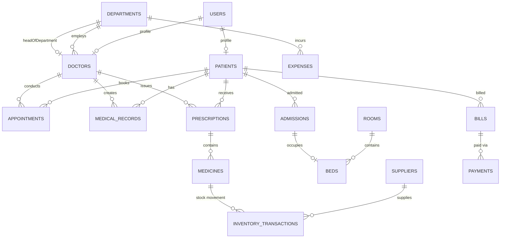

# Smart Healthcare & Hospital Management System: Database Schema Design

## 1. Overview & Data Integrity Principles

The system uses **MongoDB with Mongoose ODM**. To guarantee production readiness, all schemas enforce:
- **Strict Data Types & Enum Constraints**: Restricting status, role, blood group, department, and category values.
- **Unique Indexes & Compound Indexes**: Auto-generated business IDs (`PID-XXXX`, `DOC-XXXX`, `INV-XXXX`), email uniqueness, and compound lookup indexes (e.g. `[doctorId, date]`).
- **Audit Fields**: Every schema tracks `createdAt`, `updatedAt`, and where applicable `createdBy` / `updatedBy`.
- **Soft Deletion & Status Flags**: For users, doctors, medicines, and admissions to maintain audit integrity without data loss.
- **Relational Integrity via ObjectId References**: Connecting patients, doctors, admissions, bills, and prescriptions.

---

## 2. Entity Relationship Diagram (Core Data Model)



---

## 3. Detailed Specifications for 19 Collections

### 1. `users`
Primary authentication and credentials store for all hospital personnel and patients.
```javascript
{
  _id: ObjectId,
  email: { type: String, required: true, unique: true, lowercase: true, trim: true },
  password: { type: String, required: true }, // bcrypt hashed
  role: { 
    type: String, 
    required: true, 
    enum: ['SUPER_ADMIN', 'HOSPITAL_ADMIN', 'DOCTOR', 'PATIENT', 'PHARMACIST', 'RECEPTIONIST', 'ACCOUNTANT', 'DEPARTMENT_HEAD'] 
  },
  name: { type: String, required: true, trim: true },
  phone: { type: String, required: true },
  isActive: { type: Boolean, default: true },
  lastLogin: { type: Date },
  profileImage: { type: String, default: null },
  resetPasswordToken: { type: String },
  resetPasswordExpire: { type: Date },
  createdAt: Date,
  updatedAt: Date
}
// Indexes: { email: 1 } (unique), { role: 1 }, { isActive: 1 }
```

### 2. `patients`
Detailed demographic, personal, and clinical intake record.
```javascript
{
  _id: ObjectId,
  patientId: { type: String, required: true, unique: true }, // e.g. "PID-2026-0001"
  userId: { type: ObjectId, ref: 'User', unique: true, sparse: true },
  fullName: { type: String, required: true, trim: true },
  dateOfBirth: { type: Date, required: true },
  gender: { type: String, enum: ['Male', 'Female', 'Other'], required: true },
  bloodGroup: { type: String, enum: ['A+', 'A-', 'B+', 'B-', 'AB+', 'AB-', 'O+', 'O-'], required: true },
  phone: { type: String, required: true, index: true },
  email: { type: String, lowercase: true, trim: true },
  address: {
    street: String,
    city: String,
    state: String,
    zipCode: String
  },
  emergencyContact: {
    name: { type: String, required: true },
    relationship: { type: String, required: true },
    phone: { type: String, required: true }
  },
  medicalHistorySummary: {
    allergies: [String],
    chronicConditions: [String],
    pastSurgeries: [String]
  },
  registrationDate: { type: Date, default: Date.now },
  status: { type: String, enum: ['Active', 'Admitted', 'Discharged', 'Deceased'], default: 'Active' },
  createdAt: Date,
  updatedAt: Date
}
// Indexes: { patientId: 1 } (unique), { phone: 1 }, { fullName: 'text' }
```

### 3. `doctors`
Medical practitioner credentials, scheduling availability, and consultation parameters.
```javascript
{
  _id: ObjectId,
  doctorId: { type: String, required: true, unique: true }, // e.g. "DOC-2026-01"
  userId: { type: ObjectId, ref: 'User', required: true, unique: true },
  fullName: { type: String, required: true },
  email: { type: String, required: true },
  phone: { type: String, required: true },
  specialization: { type: String, required: true },
  qualification: { type: String, required: true },
  experienceYears: { type: Number, required: true, min: 0 },
  department: { type: ObjectId, ref: 'Department', required: true },
  consultationFee: { type: Number, required: true, min: 0 },
  availableDays: [{ 
    type: String, 
    enum: ['Monday', 'Tuesday', 'Wednesday', 'Thursday', 'Friday', 'Saturday', 'Sunday'] 
  }],
  availableTimeSlots: [{
    startTime: { type: String, required: true }, // "09:00"
    endTime: { type: String, required: true },   // "13:00"
    slotDurationMinutes: { type: Number, default: 20 }
  }],
  isDepartmentHead: { type: Boolean, default: false },
  employmentStatus: { type: String, enum: ['Active', 'On Leave', 'Resigned', 'Suspended'], default: 'Active' },
  createdAt: Date,
  updatedAt: Date
}
// Indexes: { doctorId: 1 } (unique), { department: 1 }, { employmentStatus: 1 }
```

### 4. `departments`
Clinical and administrative hospital divisions.
```javascript
{
  _id: ObjectId,
  name: { type: String, required: true, unique: true }, // e.g. "Cardiology"
  code: { type: String, required: true, unique: true }, // "CARD"
  description: { type: String },
  headOfDepartment: { type: ObjectId, ref: 'Doctor' },
  locationBuilding: { type: String },
  locationFloor: { type: String },
  budgetAllocated: { type: Number, default: 0 },
  isActive: { type: Boolean, default: true },
  createdAt: Date,
  updatedAt: Date
}
```

### 5. `appointments`
Outpatient bookings and consultation scheduling.
```javascript
{
  _id: ObjectId,
  appointmentNumber: { type: String, required: true, unique: true }, // "APT-2026-0001"
  patient: { type: ObjectId, ref: 'Patient', required: true },
  doctor: { type: ObjectId, ref: 'Doctor', required: true },
  department: { type: ObjectId, ref: 'Department', required: true },
  appointmentDate: { type: Date, required: true },
  timeSlot: {
    startTime: { type: String, required: true },
    endTime: { type: String, required: true }
  },
  symptoms: { type: String },
  status: { 
    type: String, 
    enum: ['Pending', 'Confirmed', 'Completed', 'Cancelled', 'No-show'], 
    default: 'Pending' 
  },
  cancellationReason: { type: String },
  fee: { type: Number, required: true },
  isPaid: { type: Boolean, default: false },
  createdAt: Date,
  updatedAt: Date
}
// Compound Index: { doctor: 1, appointmentDate: 1, 'timeSlot.startTime': 1 }
```

### 6. `medicalrecords`
Clinical examination, observations, diagnostics, and recovery status.
```javascript
{
  _id: ObjectId,
  recordNumber: { type: String, required: true, unique: true }, // "MR-2026-0001"
  patient: { type: ObjectId, ref: 'Patient', required: true },
  doctor: { type: ObjectId, ref: 'Doctor', required: true },
  appointment: { type: ObjectId, ref: 'Appointment' },
  admission: { type: ObjectId, ref: 'Admission' },
  examinationDate: { type: Date, default: Date.now },
  vitalSigns: {
    bloodPressure: String, // "120/80"
    heartRateBpm: Number,
    respiratoryRate: Number,
    temperatureCelsius: Number,
    oxygenSaturationPct: Number
  },
  symptoms: [String],
  clinicalObservations: { type: String, required: true },
  diagnosis: { type: String, required: true },
  treatmentPlan: { type: String, required: true },
  labTestsOrdered: [{
    testName: String,
    instructions: String,
    status: { type: String, enum: ['Ordered', 'In Progress', 'Completed'], default: 'Ordered' },
    reportUrl: String
  }],
  recoveryStatus: {
    type: String,
    enum: ['Recovered', 'Significantly Improved', 'Under Treatment', 'Critical', 'Deteriorating'],
    required: true,
    default: 'Under Treatment'
  },
  followUpDate: { type: Date },
  createdAt: Date,
  updatedAt: Date
}
// Indexes: { patient: 1, examinationDate: -1 }, { recoveryStatus: 1 }
```

### 7. `prescriptions`
Pharmaceutical orders attached to consultations or inpatient stays.
```javascript
{
  _id: ObjectId,
  prescriptionNumber: { type: String, required: true, unique: true }, // "RX-2026-0001"
  patient: { type: ObjectId, ref: 'Patient', required: true },
  doctor: { type: ObjectId, ref: 'Doctor', required: true },
  medicalRecord: { type: ObjectId, ref: 'MedicalRecord' },
  medicines: [{
    medicine: { type: ObjectId, ref: 'Medicine', required: true },
    dosage: { type: String, required: true }, // "500mg"
    frequency: { type: String, required: true }, // "Twice daily after meals"
    durationDays: { type: Number, required: true },
    quantityPrescribed: { type: Number, required: true },
    quantityDispensed: { type: Number, default: 0 },
    instructions: String
  }],
  status: { type: String, enum: ['Issued', 'Partially Dispensed', 'Dispensed', 'Cancelled'], default: 'Issued' },
  dispensedBy: { type: ObjectId, ref: 'User' },
  dispensedAt: { type: Date },
  notes: { type: String },
  createdAt: Date,
  updatedAt: Date
}
```

### 8. `medicines`
Pharmacy formulary catalog and inventory status.
```javascript
{
  _id: ObjectId,
  medicineId: { type: String, required: true, unique: true }, // "MED-001"
  name: { type: String, required: true, trim: true },
  genericName: { type: String, trim: true },
  category: { 
    type: String, 
    enum: ['Antibiotic', 'Analgesic', 'Antiviral', 'Cardiovascular', 'Antidiabetic', 'Respiratory', 'Other'],
    required: true 
  },
  manufacturer: { type: String, required: true },
  batchNumber: { type: String, required: true },
  purchasePrice: { type: Number, required: true, min: 0 },
  sellingPrice: { type: Number, required: true, min: 0 },
  availableQuantity: { type: Number, required: true, min: 0, default: 0 },
  minimumStockLevel: { type: Number, required: true, min: 0, default: 10 },
  expiryDate: { type: Date, required: true },
  supplier: { type: ObjectId, ref: 'Supplier' },
  isActive: { type: Boolean, default: true },
  createdAt: Date,
  updatedAt: Date
}
// Indexes: { name: 'text', genericName: 'text' }, { expiryDate: 1 }, { availableQuantity: 1 }
```

### 9. `inventorytransactions`
Audit trail of all medicine receipts (IN) and disbursements (OUT).
```javascript
{
  _id: ObjectId,
  transactionNumber: { type: String, required: true, unique: true }, // "TXN-2026-0001"
  medicine: { type: ObjectId, ref: 'Medicine', required: true },
  type: { type: String, enum: ['IN', 'OUT', 'ADJUSTMENT', 'DISPOSAL'], required: true },
  quantity: { type: Number, required: true, min: 1 },
  previousStock: { type: Number, required: true },
  newStock: { type: Number, required: true },
  unitCost: { type: Number },
  totalAmount: { type: Number },
  supplier: { type: ObjectId, ref: 'Supplier' }, // For type: 'IN'
  prescription: { type: ObjectId, ref: 'Prescription' }, // For type: 'OUT'
  patient: { type: ObjectId, ref: 'Patient' }, // For type: 'OUT'
  reason: { type: String },
  performedBy: { type: ObjectId, ref: 'User', required: true },
  transactionDate: { type: Date, default: Date.now },
  createdAt: Date
}
// Indexes: { medicine: 1, transactionDate: -1 }, { type: 1 }
```

### 10. `suppliers`
Wholesale drug distributors and medical equipment vendors.
```javascript
{
  _id: ObjectId,
  name: { type: String, required: true },
  contactPerson: { type: String },
  phone: { type: String, required: true },
  email: { type: String },
  address: { type: String },
  taxIdNumber: { type: String },
  isActive: { type: Boolean, default: true },
  createdAt: Date,
  updatedAt: Date
}
```

### 11. `admissions`
Inpatient hospital stay tracker from admission to clinical discharge.
```javascript
{
  _id: ObjectId,
  admissionNumber: { type: String, required: true, unique: true }, // "ADM-2026-0001"
  patient: { type: ObjectId, ref: 'Patient', required: true },
  attendingDoctor: { type: ObjectId, ref: 'Doctor', required: true },
  department: { type: ObjectId, ref: 'Department', required: true },
  facility: { type: ObjectId, ref: 'Facility', required: true },
  room: { type: ObjectId, ref: 'Room', required: true },
  bed: { type: ObjectId, ref: 'Bed', required: true },
  admissionDate: { type: Date, default: Date.now },
  admissionDiagnosis: { type: String, required: true },
  status: { 
    type: String, 
    enum: ['Admitted', 'Under Treatment', 'Discharged', 'Transferred'], 
    default: 'Admitted' 
  },
  dischargeDate: { type: Date },
  dischargeSummary: {
    finalDiagnosis: String,
    treatmentGiven: String,
    clinicalRecoveryOutcome: {
      type: String,
      enum: ['Fully Recovered', 'Partially Recovered', 'Stable', 'Unchanged', 'Expired'],
      default: 'Fully Recovered'
    },
    followUpInstructions: String
  },
  stayDurationDays: { type: Number, default: 0 },
  createdAt: Date,
  updatedAt: Date
}
// Indexes: { patient: 1 }, { status: 1 }, { bed: 1 }
```

### 12. `rooms` & 13. `beds`
Hospital lodging infrastructure hierarchy.
```javascript
// rooms collection
{
  _id: ObjectId,
  roomNumber: { type: String, required: true, unique: true },
  type: { type: String, enum: ['General', 'Semi-Private', 'Private', 'ICU', 'Emergency'], required: true },
  department: { type: ObjectId, ref: 'Department' },
  chargePerDay: { type: Number, required: true, min: 0 },
  capacity: { type: Number, required: true, min: 1 },
  isActive: { type: Boolean, default: true },
  createdAt: Date,
  updatedAt: Date
}

// beds collection
{
  _id: ObjectId,
  bedNumber: { type: String, required: true }, // e.g. "B-101-A"
  room: { type: ObjectId, ref: 'Room', required: true },
  isOccupied: { type: Boolean, default: false },
  currentAdmission: { type: ObjectId, ref: 'Admission', default: null },
  createdAt: Date,
  updatedAt: Date
}
// Indexes: { room: 1, bedNumber: 1 } (unique), { isOccupied: 1 }
```

### 14. `bills` & 15. `payments`
Invoicing, itemized services, ledger balance, and payment transactions.
```javascript
// bills collection
{
  _id: ObjectId,
  billNumber: { type: String, required: true, unique: true }, // "BILL-2026-0001"
  patient: { type: ObjectId, ref: 'Patient', required: true },
  admission: { type: ObjectId, ref: 'Admission' },
  appointment: { type: ObjectId, ref: 'Appointment' },
  items: [{
    category: { 
      type: String, 
      enum: ['Consultation', 'Admission', 'Laboratory', 'Surgery', 'Pharmacy', 'Other'], 
      required: true 
    },
    description: { type: String, required: true },
    quantity: { type: Number, default: 1 },
    unitPrice: { type: Number, required: true },
    totalPrice: { type: Number, required: true }
  }],
  subTotal: { type: Number, required: true },
  taxAmount: { type: Number, default: 0 },
  discountAmount: { type: Number, default: 0 },
  totalAmount: { type: Number, required: true },
  paidAmount: { type: Number, default: 0 },
  balanceDue: { type: Number, required: true },
  status: { type: String, enum: ['Unpaid', 'Partially Paid', 'Paid', 'Cancelled'], default: 'Unpaid' },
  dueDate: { type: Date },
  createdAt: Date,
  updatedAt: Date
}

// payments collection
{
  _id: ObjectId,
  paymentNumber: { type: String, required: true, unique: true }, // "PAY-2026-0001"
  bill: { type: ObjectId, ref: 'Bill', required: true },
  patient: { type: ObjectId, ref: 'Patient', required: true },
  amount: { type: Number, required: true, min: 0.01 },
  paymentMethod: { type: String, enum: ['Cash', 'Credit Card', 'Debit Card', 'UPI', 'Insurance', 'Bank Transfer'], required: true },
  transactionReference: { type: String },
  receivedBy: { type: ObjectId, ref: 'User', required: true },
  paymentDate: { type: Date, default: Date.now },
  createdAt: Date
}
```

### 16. `expenses`
Operational, procurement, maintenance, and facility overhead disbursements.
```javascript
{
  _id: ObjectId,
  expenseNumber: { type: String, required: true, unique: true }, // "EXP-2026-0001"
  category: { 
    type: String, 
    enum: ['Staff Salaries', 'Medicine Purchases', 'Medical Equipment', 'Electricity & Water', 'Hospital Maintenance', 'Infrastructure', 'Other Operational'],
    required: true 
  },
  department: { type: ObjectId, ref: 'Department' },
  amount: { type: Number, required: true, min: 0.01 },
  expenseDate: { type: Date, required: true },
  paymentMethod: { type: String, enum: ['Cash', 'Cheque', 'Bank Transfer', 'Credit Card'], required: true },
  recipient: { type: String, required: true },
  invoiceAttachmentUrl: { type: String },
  description: { type: String },
  recordedBy: { type: ObjectId, ref: 'User', required: true },
  createdAt: Date,
  updatedAt: Date
}
// Indexes: { category: 1 }, { expenseDate: 1 }, { department: 1 }
```

### 17. `facilities`
Hospital physical infrastructure divisions (ICU, OT, Labs, Emergency).
```javascript
{
  _id: ObjectId,
  name: { 
    type: String, 
    required: true, 
    enum: ['Emergency Department', 'ICU', 'General Ward', 'Private Rooms', 'Operation Theatre', 'Laboratory', 'Radiology', 'Pharmacy', 'Ambulance Services', 'Blood Bank'] 
  },
  department: { type: ObjectId, ref: 'Department' },
  manager: { type: ObjectId, ref: 'User' },
  totalBeds: { type: Number, default: 0 },
  occupiedBeds: { type: Number, default: 0 },
  equipmentList: [{
    name: String,
    serialNumber: String,
    status: { type: String, enum: ['Operational', 'Maintenance', 'Out of Order'], default: 'Operational' }
  }],
  operationalStatus: { type: String, enum: ['Active', 'Under Renovation', 'Closed'], default: 'Active' },
  createdAt: Date,
  updatedAt: Date
}
```

### 18. `notifications`
In-app and system alerts for clinical, administrative, and inventory events.
```javascript
{
  _id: ObjectId,
  recipient: { type: ObjectId, ref: 'User', required: true },
  type: { 
    type: String, 
    enum: [
      'APPOINTMENT_CONFIRMATION', 'APPOINTMENT_REMINDER', 'APPOINTMENT_CANCELLED',
      'PRESCRIPTION_ISSUED', 'MEDICINE_LOW_STOCK', 'MEDICINE_EXPIRY_ALERT',
      'PATIENT_ADMISSION', 'PATIENT_DISCHARGE', 'PAYMENT_REMINDER', 'SYSTEM_ALERT'
    ], 
    required: true 
  },
  title: { type: String, required: true },
  message: { type: String, required: true },
  metadata: { type: Map, of: String },
  isRead: { type: Boolean, default: false },
  createdAt: { type: Date, default: Date.now }
}
// Indexes: { recipient: 1, isRead: 1, createdAt: -1 }
```

### 19. `auditlogs`
Immutable compliance records for security, clinical access, and financial changes.
```javascript
{
  _id: ObjectId,
  user: { type: ObjectId, ref: 'User' },
  action: { type: String, required: true }, // e.g., "DISPENSE_MEDICINE", "DISCHARGE_PATIENT"
  module: { type: String, required: true }, // e.g., "PHARMACY", "BILLING", "CLINICAL"
  targetEntity: { type: String }, // e.g., "Patient", "Bill"
  targetId: { type: String },
  ipAddress: { type: String },
  userAgent: { type: String },
  changes: {
    before: { type: Object },
    after: { type: Object }
  },
  timestamp: { type: Date, default: Date.now }
}
// Indexes: { timestamp: -1 }, { user: 1 }, { module: 1 }
```
