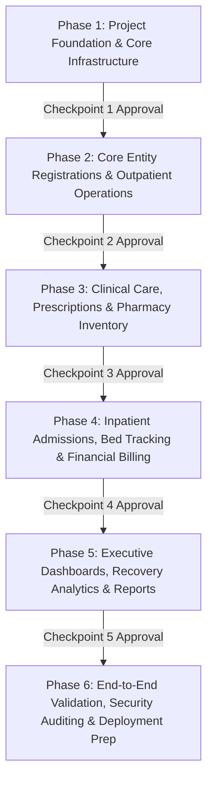

# Smart Healthcare & Hospital Management System: Phased Implementation Roadmap

## 1. Roadmap Architecture & Development Protocol

To comply with the instruction:
> *"Implement features module by module. Never overwrite existing working code without reviewing it. Test each module before moving to the next. Wait for approval after each major development phase."*

The implementation is broken into **6 structured phases**:

---

## 2. Phase-by-Phase Breakdown & Deliverables

### Phase 1: Project Foundation & Core Infrastructure
*Focus: Environment setup, baseline packages, security middleware, JWT auth, RBAC matrix, database connection, seed runner, base frontend layout.*

- **Backend Deliverables**:
  - `backend/package.json` with express, mongoose, jsonwebtoken, bcryptjs, cors, helmet, dotenv, express-validator, morgan, winston.
  - Server bootloader (`server.js`) with graceful shutdown and MongoDB connection with retry logic.
  - `src/config/db.js` and `src/config/constants.js`.
  - Base Mongoose Models: `User`, `Department`, `AuditLog`, `Notification`.
  - Authentication controller & routes (`/api/v1/auth/login`, `/register`, `/me`, `/forgot-password`, `/reset-password`).
  - Security middlewares: `verifyToken`, `authorizeRoles`, `auditLogger`, `rateLimiter`, `errorHandler`.
  - Initial database seeder script (`src/seeders/seedAdminAndDepartments.js`) for initializing Super Admin, Hospital Admin, and standard clinical departments.
- **Frontend Deliverables**:
  - Setup React application (`frontend/package.json`) with Vite, Tailwind CSS, Redux Toolkit, React Router DOM, Lucide React.
  - Redux store configuration with `authSlice` and API base client.
  - Responsive Dashboard Layout Shell: Collapsible Sidebar, Header with notifications drawer, Role-based route guards (`ProtectedRoute`, `RoleGuard`).
  - Authentication screens: Login, Forgot Password, Reset Password.
- **Verification Gate**:
  - [x] Backend connects cleanly to MongoDB.
  - [x] JWT authentication works with bcrypt password verification.
  - [x] Protected routes enforce RBAC (401 for unauthorized, 403 for forbidden roles).
  - [x] Audit log entry created on login and user status change.
  - [x] Git commit: `feat(core): initialize project foundation and authentication`.

---

### Phase 2: Core Entity Registrations & Outpatient Operations
*Focus: Patient intake, doctor management, department assignments, and appointment scheduling.*

- **Backend Deliverables**:
  - Mongoose Models: `Patient`, `Doctor`, `Appointment`.
  - ID Generators: Auto-incrementing, collision-safe IDs (`PID-YYYY-XXXX`, `DOC-YYYY-XXXX`, `APT-YYYY-XXXX`).
  - Patient Controller & Routes: CRUD, phone/name text search, pagination.
  - Doctor Controller & Routes: CRUD, availability schedules, fee structure, department link.
  - Appointment Controller & Routes: Slot conflict detection, status progression (`Pending` -> `Confirmed` -> `Completed` / `Cancelled`), booking validation.
- **Frontend Deliverables**:
  - Patient Directory & Registration Wizard with real-time field validation.
  - Doctor Directory & Schedule Management UI.
  - Appointment Booking & Calendar UI (patient & doctor views).
- **Verification Gate**:
  - [x] Duplicate appointment booking on the same doctor/timeslot is rejected.
  - [x] Patient profile links automatically to user account if created by patient.
  - [x] Search queries execute efficiently with text index.
  - [x] Git commit: `feat(outpatient): patient, doctor, and appointment management`.

---

### Phase 3: Clinical Care, Prescriptions & Pharmacy Inventory
*Focus: Electronic medical records (EMR), diagnosis, prescription writing, medicine stock IN/OUT transactions.*

- **Backend Deliverables**:
  - Mongoose Models: `MedicalRecord`, `Prescription`, `Medicine`, `InventoryTransaction`, `Supplier`.
  - Medical Record Service: Vital signs logging, symptoms, diagnosis, treatment plans, clinical recovery indicators.
  - Prescription Workflow: Doctor prescribes medication with dosage, route, frequency, and duration.
  - Pharmacy & Inventory Engine: Stock IN (supplier purchase) and Stock OUT (dispensing against prescription) with ACID multi-document MongoDB transactions preventing negative inventory.
  - Automated threshold alerts for `availableQuantity <= minimumStockLevel` and near-expiry drugs.
- **Frontend Deliverables**:
  - Doctor Clinical Consultation Portal: Medical record creation, Rx builder.
  - Patient Medical Record & Prescription Viewer.
  - Pharmacist Management Portal: Catalog, Stock IN modal, Prescription Dispensation terminal, Low-Stock badge alerts.
- **Verification Gate**:
  - [x] Prescribing medicines and dispensing decrements stock atomically.
  - [x] Dispensing more than available stock is rejected with a 400 Bad Request.
  - [x] Clinical diagnosis strictly restricted to authorized medical practitioners.
  - [x] Git commit: `feat(clinical): medical records, prescriptions, and pharmacy stock management`.

---

### Phase 4: Inpatient Admissions, Bed Tracking & Financial Billing
*Focus: Bed matrix, admission/discharge clinical tracking, invoice generation, payment ledger, and operational expenses.*

- **Backend Deliverables**:
  - Mongoose Models: `Facility`, `Room`, `Bed`, `Admission`, `Bill`, `Payment`, `Expense`.
  - Bed Allocation Engine: Real-time bed occupancy toggle on patient admission and release on discharge.
  - Clinical Discharge Protocol: Discharge summary, duration of stay calculation, clinical outcome tagging.
  - Billing & Invoicing Engine: Auto-aggregation of consultation fees, room rent ($/day * days), lab charges, and pharmacy orders into itemized `Bill`.
  - Payment Ledger: Cash, card, UPI, or insurance transactions updating `paidAmount` and `balanceDue`.
  - Operational Expense Service: Recording salary, equipment, maintenance, utility disbursements.
- **Frontend Deliverables**:
  - Bed Availability & Ward Management Visual Grid.
  - Patient Admission & Discharge Workflow.
  - Invoicing & POS Payment Terminal for Hospital Accountants.
  - Expense Management & Receipt Logging Dashboard.
- **Verification Gate**:
  - [x] Bed status switches to `occupied: true` immediately upon admission and `false` upon discharge.
  - [x] Bill balance updates accurately with each partial or full payment.
  - [x] Git commit: `feat(finance-bed): inpatient admissions, bed allocation, billing and expenses`.

---

### Phase 5: Executive Dashboards, Recovery Analytics & Reports
*Focus: Multi-role dashboards, clinical recovery analytics, financial P&L, Recharts visualizations, PDF/Excel export.*

- **Backend Deliverables**:
  - Analytics Aggregation Pipelines (`analyticsService.js`):
    - Admin KPI cards (Total patients, revenue, expenses, net operating income, bed occupancy rate).
    - Recovery Metrics: Distribution of clinical outcomes (Recovered vs Under Treatment vs Deteriorating), department recovery rates.
    - Financial Trend Pipelines: Monthly revenue vs expense comparison for the last 12 months.
  - Export Service: PDF generation for Patient Discharge Summaries, Invoices, and Financial Statements.
- **Frontend Deliverables**:
  - Role-specific Dashboards:
    - **Super Admin & Hospital Admin**: Operational & Financial Analytics with date filters (Today, This Week, This Month, Custom).
    - **Doctor**: Assigned patients, today's schedule, pending consults.
    - **Patient**: Upcoming visits, active prescriptions, billing receipts.
    - **Pharmacist**: Stock valuation, low-stock warnings, dispensing rate.
    - **Accountant**: Cash flow, accounts receivable, expense breakdown.
    - **Department Head**: Departmental workload, staff roster, recovery rate.
  - Interactive Recharts components: Multi-line trends, bar comparisons, doughnut distribution charts.
- **Verification Gate**:
  - [x] All PRD-required charts render with dynamic API data.
  - [x] PDF reports download with professional layout.
  - [x] Git commit: `feat(analytics): analytical dashboards and reporting engine`.

---

### Phase 6: End-to-End Validation, Security Auditing & Deployment Prep
*Focus: Integration testing, rate-limiting, CORS, security header audits, environment configuration, and production readiness.*

- **Backend Deliverables**:
  - Comprehensive API integration tests for critical user journeys (Register -> Book -> Consult -> Prescribe -> Dispense -> Bill -> Pay).
  - Rate limiting & input sanitization audit.
  - Production `.env` templates and containerized/deployable configuration.
- **Frontend Deliverables**:
  - End-to-end responsive UI check across mobile, tablet, and desktop breakpoints.
  - Production bundle optimization.
- **Verification Gate**:
  - [x] All endpoints pass security and boundary validation.
  - [x] Zero console errors or unhandled promise rejections.
  - [x] Git commit: `feat(release): production hardening and release package`.
